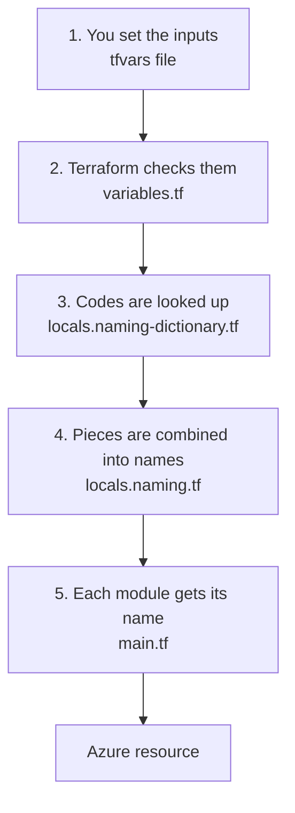

# How the METLEN names are built in Terraform

This guide explains how the Terraform locals in
[environments/metlenwithnaming](../environments/metlenwithnaming) turn a few
inputs into the resource names required by the METLEN Azure Naming Standard
v0.2. For the requested and implemented names per resource, see
[naming-standard-v0.2-implementation.md](naming-standard-v0.2-implementation.md).

Examples use the standard's tokens IT / PPA / ECM / DEV in Sweden Central.

## 1. Files involved

| File | Role |
|---|---|
| [locals.naming-dictionary.tf](../environments/metlenwithnaming/locals.naming-dictionary.tf) | Controlled dictionary: allowed token values, region codes and resource-type codes. The only place codes are defined. |
| [locals.naming.tf](../environments/metlenwithnaming/locals.naming.tf) | Building-block locals and `local.resource_names`, the map of every generated name. |
| [locals.private-connectivity.tf](../environments/metlenwithnaming/locals.private-connectivity.tf) | Private endpoint names, derived from the parent resource names. |
| [variables.tf](../environments/metlenwithnaming/variables.tf) | Naming inputs and the validations that reject invalid or duplicate names at `terraform plan`. |
| [main.tf](../environments/metlenwithnaming/main.tf) | Passes each generated name to its module. Modules never build names. |
| [outputs.tf](../environments/metlenwithnaming/outputs.tf) | `generated_resource_names` shows every generated name. |

## 2. Flow

A name is built in five steps. Each step lives in one file:



The same five steps for one Storage Account:

| Step | File | What happens | Result |
|---|---|---|---|
| 1. Inputs | `lab.tfvars` | You set the tokens, the region and the instance number | `naming_tokens = { IT, PPA, ECM, DEV }`, `location = "swedencentral"`, `storage_accounts.primary.sequence = "00"` |
| 2. Checks | `variables.tf` | Unknown tokens, unknown regions, names that would be too long and duplicate numbers stop the plan | Inputs accepted |
| 3. Look-ups | `locals.naming-dictionary.tf` | The region and the resource type are translated into METLEN codes | `swedencentral` → `SWE`, Storage Account → `SOA` |
| 4. Assembly | `locals.naming.tf` | The pieces are joined in the order the standard prescribes | `mazu` + `soa` + `itppaecmdevswe` + `00` = `mazusoaitppaecmdevswe00` |
| 5. Use | `main.tf` | The module receives the finished name | `name = local.resource_names.storage_accounts["primary"]` |

Private endpoint names are one step later: they take the finished parent name
and add the service, for example `mazusoaitppaecmdevswe00-blob`
(`locals.private-connectivity.tf`).

Every name is a pure function of the inputs: no random values, dates or
lookups in Azure. The same inputs always produce the same names (acceptance
test AT-02).

## 3. Inputs

| Input | Used for | Example |
|---|---|---|
| `naming_tokens.business_unit` | BU | `IT` |
| `naming_tokens.department` | DPT | `PPA` |
| `naming_tokens.application` | APP | `ECM` |
| `naming_tokens.environment` | ENV | `DEV` (only DEV, UAT, PRD) |
| `location` | REG, through the dictionary | `swedencentral` → `SWE` |
| `<resource>.sequence` | NN of each resource | `"00"`, `"01"`… |
| `virtual_networks.<key>.classification` | PUB/PRV of the VNet, its subnets, NAT Gateway and Public IP, and of the NSGs and route tables its subnets use | `"PRV"` (default), `"PUB"` |
| `network_security_groups.<key>.classification`, `route_tables.<key>.classification` | PUB/PRV; must match the VNet whose subnets use the group or table | `null` (default: that VNet's) |
| `virtual_networks.<key>.subnets.<subnet key>.number` | NN of that subnet's name (required), unique within its VNet | `1`, `9` |
| `app_service_plans.<key>.sequence`, `function_apps.<key>.storage_sequence`, `function_apps.<key>.sequence`, `sql_managed_instances.<key>.network_sequence` | NN of App Service Plans and of resources created for a service | `"00"`, `"01"` |
| `virtual_networks.<key>.nat_gateway.sequence`, `log_analytics_workspace.sequence`, `application_insights.sequence` | NN of the VNet's NAT Gateway (and its Public IP), of the shared Log Analytics workspace and of the shared Application Insights resource | `"00"` (default) |
| `storage_accounts.<key>.containers`, the `file_shares` keys, `<server>.database_name`, `cosmos_db_accounts.<key>.container_name` | Names chosen by the application, used as-is (no convention) | `"invoices"`, `"appdb"` |

Logical keys in maps (for example `storage_accounts.primary`) never appear in
METLEN names. They identify a resource inside Terraform and link resources to
each other, for example a Container Apps environment to its subnet. The one
exception is outside the standard: a database or Cosmos DB container without
`database_name` / `container_name` is called after its entry key.

## 4. The dictionary

`local.naming_dictionary` is the controlled register in code:

```hcl
naming_dictionary = {
  business_units = ["IT"]
  departments    = ["PPA"]
  applications   = ["ECM", "GEO"]          # GEO: sandbox test token
  environments   = ["DEV", "UAT", "PRD"]

  network_classifications = ["PUB", "PRV"]

  region_codes = {
    westeurope         = "WEU"
    swedencentral      = "SWE"              # assumption until D-02
    germanywestcentral = "GWC"              # assumption until D-02
  }

  resource_codes = {
    resource_group  = "RGP"
    storage_account = "SOA"
    key_vault       = "KVA"
    # … one entry per resource type
  }
}
```

The validations in `variables.tf` read this map, so a token, location or code
that is not listed fails at `terraform plan` (the standard's "fail closed"
rule). Changing a value here changes every name that uses it.

## 5. Building blocks

| Local | Expression | Example value |
|---|---|---|
| `metlen_codes` | `local.naming_dictionary.resource_codes` | `{ resource_group = "RGP", … }` |
| `region_code` | `naming_dictionary.region_codes[lower(replace(var.location, " ", ""))]` | `SWE` (also from `"Sweden Central"`) |
| `metlen_scope` | `"<BU>-<DPT>-<APP>"` | `IT-PPA-ECM` |
| `metlen_placement` | `"<ENV>-<REG>"` | `DEV-SWE` |
| `metlen_compact_tokens` | `lower("<BU><DPT><APP><ENV><REG>")` | `itppaecmdevswe` |
| `metlen_subnet_prefix` | `"<DPT><APP><ENV>"` | `PPAECMDEV` |

The standard's grammar is split into **scope** and **placement** so the
optional PUB/PRV classifier can sit between them:

```text
M-AZU - <TYPE> - <BU>-<DPT>-<APP> - [PUB|PRV] - <ENV>-<REG> - [NN]
                 └─ metlen_scope ─┘             └ metlen_placement ┘
```

## 6. Name families

All names come from five patterns built on the same building blocks.

### 6.1 Full family

`M-AZU-<TYPE>-<BU>-<DPT>-<APP>-<ENV>-<REG>[-NN]`, for resources that accept
uppercase and hyphens.

```hcl
resource_group = "M-AZU-${local.metlen_codes.resource_group}-${local.metlen_scope}-${local.metlen_placement}"
# M-AZU-RGP-IT-PPA-ECM-DEV-SWE

app_service_plans = {
  for key, plan in var.app_service_plans :
  key => join("-", ["M-AZU", local.metlen_codes.app_service_plan, local.metlen_scope, local.metlen_placement, plan.sequence])
}
# web → M-AZU-ASP-IT-PPA-ECM-DEV-SWE-00

web_apps = {
  for key, app in var.web_apps : key => {
    name = join("-", ["M-AZU", local.metlen_codes.app_service, local.metlen_scope, local.metlen_placement, app.sequence])
  }
}
# primary.name → M-AZU-APP-IT-PPA-ECM-DEV-SWE-00
```

`join("-", [...])` assembles the parts. When NN is optional, `compact()` drops
an empty part, so no trailing hyphen is left:

```hcl
name = join("-", compact(["M-AZU", local.metlen_codes.function_app, local.metlen_scope, local.metlen_placement, app.sequence]))
# function_apps.<key>.sequence = null  → M-AZU-FUN-IT-PPA-ECM-DEV-SWE
# function_apps.<key>.sequence = "01"  → M-AZU-FUN-IT-PPA-ECM-DEV-SWE-01
```

Used for: Resource Group, Web App, App Service Plans, Function App, Container
Apps Environment, Load Balancer, SQL elastic pool, Log Analytics workspace,
Application Insights.

### 6.2 Network family

Full family with the PUB/PRV classifier between scope and placement:

```hcl
virtual_network_names = {
  for key, network in var.virtual_networks :
  key => join("-", ["M-AZU", local.metlen_codes.virtual_network, local.metlen_scope, network.classification, local.metlen_placement])
}
# main = {}                         → M-AZU-VNT-IT-PPA-ECM-PRV-DEV-SWE
# edge = { classification = "PUB" } → M-AZU-VNT-IT-PPA-ECM-PUB-DEV-SWE

network_security_groups = {
  for key, nsg in var.network_security_groups :
  key => join("-", compact(["M-AZU", local.metlen_codes.network_security_group, local.metlen_scope, coalesce(nsg.classification, <classification of the NSG's VNet>), local.metlen_placement, nsg.sequence]))
}
# compute = { sequence = "01" }        → M-AZU-NSG-IT-PPA-ECM-PRV-DEV-SWE-01
# dmz     = { virtual_network = "edge" } → M-AZU-NSG-IT-PPA-ECM-PUB-DEV-SWE
```

Used for: VNets, NSGs (including the SQL Managed Instance and Databricks
NSGs), route tables (including the SQL Managed Instance route table), NAT
Gateways and their Public IPs (`M-AZU-NGW-…-<PUB|PRV>-<ENV>-<REG>-<NN>`, one
per VNet). The VNet has no NN in the standard, so its classification (the
network intent) is what tells VNets apart: there is at most one PRV and one
PUB VNet. Everything attached to a VNet takes its classification unless an
NSG or route table sets its own. The Public IP mirrors its NAT Gateway's name
so the pair is visibly linked; there the classifier names the VNet the address
serves, not its exposure.

VNet peerings and Private DNS zone links have no code in the standard and are
derived from VNet names instead: a peering is
`<local VNet name>-to-<remote VNet name>` (for example
`M-AZU-VNT-IT-PPA-ECM-PRV-DEV-SWE-to-M-AZU-VNT-IT-PPA-ECM-PUB-DEV-SWE`, at
most 80 characters, never truncated), and a link takes the name of the VNet it
links (link names are scoped to their zone).

### 6.3 Lowercase variant

The full family passed through `lower()`, for globally unique DNS names that
must be lowercase:

```hcl
server_name = lower(join("-", ["M-AZU", local.metlen_codes.azure_sql_server, local.metlen_scope, local.metlen_placement, server.sequence]))
# m-azu-sql-it-ppa-ecm-dev-swe-00
```

Used for: SQL logical server, PostgreSQL and MySQL servers, Container Apps,
Cosmos DB account.

### 6.4 Compact family

`mazu<code><BU><DPT><APP><ENV><REG><NN>`, lowercase letters and digits only,
for resources that allow no hyphens:

```hcl
storage_accounts = {
  for key, account in var.storage_accounts :
  key => "mazu${lower(local.metlen_codes.storage_account)}${local.metlen_compact_tokens}${account.sequence}"
}
# mazu + soa + itppaecmdevswe + 00 → mazusoaitppaecmdevswe00 (23 characters)
```

Used for: Storage Accounts (general-purpose, Premium Files, Function host
storage), Key Vaults, Container Registries.

### 6.5 Subnet family

`<DPT><APP><ENV><PUB|PRV><NN>` with a two-digit number, as in the register
example `PPAECMDEVPRV01`:

```hcl
subnets = {
  for subnet_key, subnet in network.subnets :
  subnet_key => format("%s%s%02d", local.metlen_subnet_prefix, network.classification, subnet.number)
}
# private_endpoints = { number = 1 } in a PRV VNet → PPAECMDEVPRV01
# virtual_machines  = { number = 2 } in a PUB VNet → PPAECMDEVPUB02
```

`format("%02d", …)` pads the number to two digits. PUB/PRV is the
classification of the subnet's VNet and NN the `number` set on each subnet in
`virtual_networks.<key>.subnets`, including the `container_apps/<key>` and
`databricks/<key>/<host|container>` subnets. Numbers are required and need
only be unique within their VNet; only listed subnets get a name.

### 6.6 Derived names

Private endpoints are not built from tokens but from their parent's final
name, following `<PARENTNAME>-<SERVICE>` (locals.private-connectivity.tf):

```hcl
private_endpoint_parent_names = merge(
  { for key, app in local.resource_names.web_apps : "web_app/${key}" => app.name },
  { for key, app in local.resource_names.function_apps : "function_app/${key}" => app.name },
  { for key, name in local.resource_names.storage_accounts : "storage/${key}" => name },
  …
)

private_endpoint_names = {
  for key, endpoint in local.private_endpoint_catalog : key => {
    name                            = "${local.private_endpoint_parent_names[endpoint.target]}-${lower(endpoint.subresource)}"
    private_service_connection_name = "${local.private_endpoint_parent_names[endpoint.target]}-${lower(endpoint.subresource)}"
    private_dns_zone_group_name     = "default"
  }
}
# storage/primary/blob → mazusoaitppaecmdevswe00-blob
# key_vault/primary    → mazukvaitppaecmdevswe00-vault
```

When a parent's name changes, its endpoints follow automatically.

## 7. Name per resource

| Resource | `local.resource_names.…` | Family | Example |
|---|---|---|---|
| Subscription display name (output only) | `subscription_display_name` | Full, `<BU>-<DPT>` only | `M-AZU-SBS-IT-PPA` |
| Resource Group | `resource_group` | Full | `M-AZU-RGP-IT-PPA-ECM-DEV-SWE` |
| Virtual Networks | `virtual_networks[<key>].name` | Network | `M-AZU-VNT-IT-PPA-ECM-PRV-DEV-SWE` |
| Subnets | `virtual_networks[<key>].subnets[<subnet key>]` (every listed subnet, including `container_apps/<key>` and `databricks/<key>/<host\|container>`) | Subnet | `PPAECMDEVPRV01`, `PPAECMDEVPUB02` |
| VNet peerings | `hub_peerings[<key>].spoke_to_hub` / `.hub_to_spoke`, `virtual_network_peerings[<local>-to-<remote>]` | Derived from VNet names | `M-AZU-VNT-…-PRV-DEV-SWE-to-vnet-hub` |
| Private DNS zone links | `private_dns_links[<key>]` | Derived: the VNet name | `M-AZU-VNT-IT-PPA-ECM-PRV-DEV-SWE` |
| NSGs | `network_security_groups[<key>]`, `sql_managed_instances[<key>].network_security_group_name` | Network | `M-AZU-NSG-IT-PPA-ECM-PRV-DEV-SWE-01` |
| Route tables | `route_tables[<key>]`, `sql_managed_instances[<key>].route_table_name` | Network | `M-AZU-UDR-IT-PPA-ECM-PRV-DEV-SWE` |
| Storage Accounts | `storage_accounts[<key>]`, `premium_file_accounts[<key>]`, `function_apps[<key>].storage_account_name` | Compact | `mazusoaitppaecmdevswe00` |
| Key Vaults | `key_vaults[<key>]` | Compact | `mazukvaitppaecmdevswe00` |
| Container Registries | `container_registries[<key>]` | Compact | `mazuacritppaecmdevswe00` |
| SQL server / database | `azure_sql_servers[<key>].server_name` / `.database_name` | Lowercase / chosen by the application | `m-azu-sql-it-ppa-ecm-dev-swe-00` / `database_name`, default the key |
| SQL elastic pool | `azure_sql_servers[<key>].elastic_pool_name` | Full | `M-AZU-SEL-IT-PPA-ECM-DEV-SWE-00` |
| SQL Managed Instance | `sql_managed_instances[<key>].name` | Lowercase | `m-azu-smi-it-ppa-ecm-dev-swe-00` |
| PostgreSQL server / database | `postgresql_servers[<key>]…` | Lowercase / chosen by the application | `m-azu-pgs-…-00` / `database_name`, default the key |
| MySQL server / database | `mysql_servers[<key>]…` | Lowercase / chosen by the application (lowercase) | `m-azu-mys-…-00` / `database_name`, default the key |
| Cosmos DB account | `cosmos_db_accounts[<key>]` | Lowercase | `m-azu-cdb-it-ppa-ecm-dev-swe-00` |
| Cosmos DB database / container | `cosmos_db_databases[<key>]`, `cosmos_db_containers[<key>]` | Chosen by the application | `database_name` / `container_name`, default the key |
| Blob containers, file shares | `storage_containers[<key>]`, `storage_file_shares[<key>]`, `premium_file_shares[<key>]` | Chosen by the application | Exactly as configured, e.g. `invoices` |
| App Service Plans | `app_service_plans[<key>]` | Full | `M-AZU-ASP-IT-PPA-ECM-DEV-SWE-00` |
| Web App | `web_apps[<key>].name` (plan selected by `web_apps.<key>.service_plan`) | Full | `M-AZU-APP-…-00` |
| Function App | `function_apps[<key>].name` (plan selected by `function_apps.<key>.service_plan`) | Full | `M-AZU-FUN-IT-PPA-ECM-DEV-SWE` |
| Container Apps environment | `container_apps_environments[<key>].name` | Full | `M-AZU-CEV-IT-PPA-ECM-DEV-SWE-00` |
| Container Apps | `container_apps_environments[<key>].apps[<app>]` | Lowercase | `m-azu-cap-it-ppa-ecm-dev-swe-00` |
| Databricks workspace / Access Connector | `databricks_workspaces[<key>].name` / `.access_connector_name` | Full | `M-AZU-DBR-IT-PPA-ECM-DEV-SWE-00` (both) |
| Databricks managed resource group | `databricks_workspaces[<key>].managed_resource_group_name` | Full (RGP with the workspace NN) | `M-AZU-RGP-IT-PPA-ECM-DEV-SWE-00` |
| Databricks root (DBFS) storage | `databricks_workspaces[<key>].root_storage_account_name` (null without `storage_sequence`) | Compact | `mazusoaitppaecmdevswe08` |
| Databricks NSG | `databricks_workspaces[<key>].network_security_group_name` | Network | `M-AZU-NSG-IT-PPA-ECM-PRV-DEV-SWE-00` |
| Load Balancer | `load_balancers[<key>].name` | Full | `M-AZU-LBL-IT-PPA-ECM-DEV-SWE-00` |
| Load Balancer parts | `load_balancers[<key>].frontend_ip_configuration_name`, … | Fixed / key | `frontend`, `backend`, `http` |
| NAT Gateway / its Public IP | `nat_gateways[<VNet key>].name` / `.public_ip_name` (NN from `virtual_networks.<key>.nat_gateway.sequence`; only VNets with a `nat_gateway = true` subnet) | Network | `M-AZU-NGW-IT-PPA-ECM-PRV-DEV-SWE-00` / `M-AZU-PIP-IT-PPA-ECM-PRV-DEV-SWE-00` |
| Log Analytics workspace | `log_analytics_workspace` (NN from `log_analytics_workspace.sequence`) | Full | `M-AZU-LAW-IT-PPA-ECM-DEV-SWE-00` |
| Application Insights | `application_insights` (NN from `application_insights.sequence`) | Full | `M-AZU-AIN-IT-PPA-ECM-DEV-SWE-00` |
| Function App content share | `function_apps[<key>].content_share_name` | Fixed | `function-content` |
| Private Endpoints | `local.private_endpoint_names[<endpoint>]` | Derived | `mazusoaitppaecmdevswe00-blob` |

## 8. How names reach Azure

The environment generates every name; modules only receive them:

```hcl
# main.tf
module "storage" {
  for_each = var.storage_accounts
  source   = "../../modules/storage-account"

  name = local.resource_names.storage_accounts[each.key]
  # …
}
```

The same logical key (`each.key`) selects the configuration in the tfvars and
the generated name. To see all names before deploying:

```powershell
terraform plan -var-file="lab.tfvars"          # names appear in the plan
terraform console -var-file="lab.tfvars"
> local.resource_names.storage_accounts
```

After apply, `terraform output generated_resource_names` lists every name.

## 9. Guardrails

`variables.tf` validates the inputs before any name is used. All checks run at
`terraform plan`:

| Check | Why |
|---|---|
| BU, DPT, APP and ENV must be in the dictionary | Fail closed on unknown tokens (AT-07) |
| `location` must have a region code | REG is always defined |
| BU + DPT + APP at most 9 characters | Compact names fit 24 characters; Container App and Function App names fit 32 |
| Every `sequence` is two digits; every subnet `number` is 1-99 | Consistent NN. The NN is optional (`null`) for NSGs, route tables, `function_apps.<key>.sequence` (at most one app) and `sql_managed_instances.<key>.network_sequence`, which follow examples without NN |
| NN unique per resource type | Two resources never get the same name |
| Storage NN unique across general-purpose, Premium Files and Function storage | They share one family |
| App Service Plan NN set only in `app_service_plans`; apps select a plan by key | Web App and Function App plans share the ASP family, so a single map keeps their names unique |
| Web Apps only on Basic/Standard/Premium plans, Function Apps only on Elastic Premium plans, and every app's OS matches its plan | A plan never mixes app types, and Azure rejects an app whose OS differs from its plan |
| Container App NN unique across all environments | Container App names are unique per resource group |
| NSG and route table names unique, including the SQL MI ones | Same family and classification |
| Subnet numbers unique within each VNet | Subnet names must be unique |
| PUB/PRV values only | Controlled classifier |
| Blob container, file share, database and Cosmos DB container names meet Azure's rules (length, characters, no system database names, lowercase MySQL databases, per-API Cosmos DB rules) | Names chosen by the application are used as-is, so they are checked before Azure rejects them |

The checks reference `local.naming_dictionary` directly, which Terraform
allows from version 1.9. They cannot reference `local.resource_names`,
because the names depend on the same variables and Terraform would report a
dependency cycle; for that reason each uniqueness check repeats the inputs
instead of comparing finished names.

The tests in [tests/naming.tftest.hcl](../environments/metlenwithnaming/tests/naming.tftest.hcl)
pin the expected names, including the register's examples and the NAT Gateway,
Public IP and Log Analytics codes agreed on 2026-10-28, and check that invalid
inputs are rejected. The names of the working-assumption types (Container
Registry, Cosmos DB, PostgreSQL, MySQL) and the SQL elastic pool are pinned
with their resources in
[tests/configuration.tftest.hcl](../environments/metlenwithnaming/tests/configuration.tftest.hcl),
and the Application Insights name (`AIN`, agreed on 2026-10-29) in
[tests/application-insights.tftest.hcl](../environments/metlenwithnaming/tests/application-insights.tftest.hcl).

## 10. Sample naming still in the locals

Resources without a METLEN convention still use the earlier sample naming
`<prefix>-<project>-<environment>-<suffix>`:

```hcl
naming_suffix   = coalesce(var.naming.unique_suffix, random_string.suffix.result)
name_stem       = "${var.project_name}-${var.environment}-${local.naming_suffix}"
naming_prefixes = var.naming.prefixes
```

This covers VMs and scale sets with their NICs and disks (the register marks
Virtual Machine as EXCEPTION: they follow the METLEN server naming process once
it is available), and names inside resources (subnet delegations, Container
Apps containers and workload profiles). Blob containers, file shares and
databases are not part of it: they are chosen by the application and used as
configured. The Function App content share is always `function-content`.
These locals and inputs will be removed when the last of them has a METLEN
convention.

## 11. Common changes

| Change | Where | Effect |
|---|---|---|
| Approve a new BU, DPT or APP value | Add it to the list in `naming_dictionary` | The value is accepted in `naming_tokens` |
| Change a resource code, for example `KVA` to `KV` | `resource_codes` | Every name of that type changes |
| Add a region | `region_codes`, for example `northeurope = "NEU"` | The location is accepted and gets its code |
| Add a resource type | Code in `resource_codes`, `sequence` input with validations in `variables.tf`, entry in `resource_names`, module call using it, test | The new type follows the chosen family |
| Pick another instance number | `sequence` of that resource in the tfvars | That resource gets a new name |

A changed name means Azure **replaces** the resource: Terraform deletes the
old one and creates a new one. Check `terraform plan` for `must be replaced`
before applying a naming change to resources that hold data.

## 12. Worked example

Inputs:

```hcl
location      = "swedencentral"
naming_tokens = { business_unit = "IT", department = "PPA", application = "ECM", environment = "DEV" }
storage_accounts = { primary = { sequence = "00" } }
```

| Step | Value |
|---|---|
| `region_code` = `region_codes["swedencentral"]` | `SWE` |
| `metlen_compact_tokens` = `lower("IT" + "PPA" + "ECM" + "DEV" + "SWE")` | `itppaecmdevswe` |
| `lower(metlen_codes.storage_account)` | `soa` |
| `storage_accounts["primary"]` = `"mazu" + "soa" + "itppaecmdevswe" + "00"` | `mazusoaitppaecmdevswe00` |
| Blob private endpoint = parent name + `-` + `lower("blob")` | `mazusoaitppaecmdevswe00-blob` |
| `metlen_scope` + `metlen_placement` | `IT-PPA-ECM`, `DEV-SWE` |
| `resource_group` | `M-AZU-RGP-IT-PPA-ECM-DEV-SWE` |
