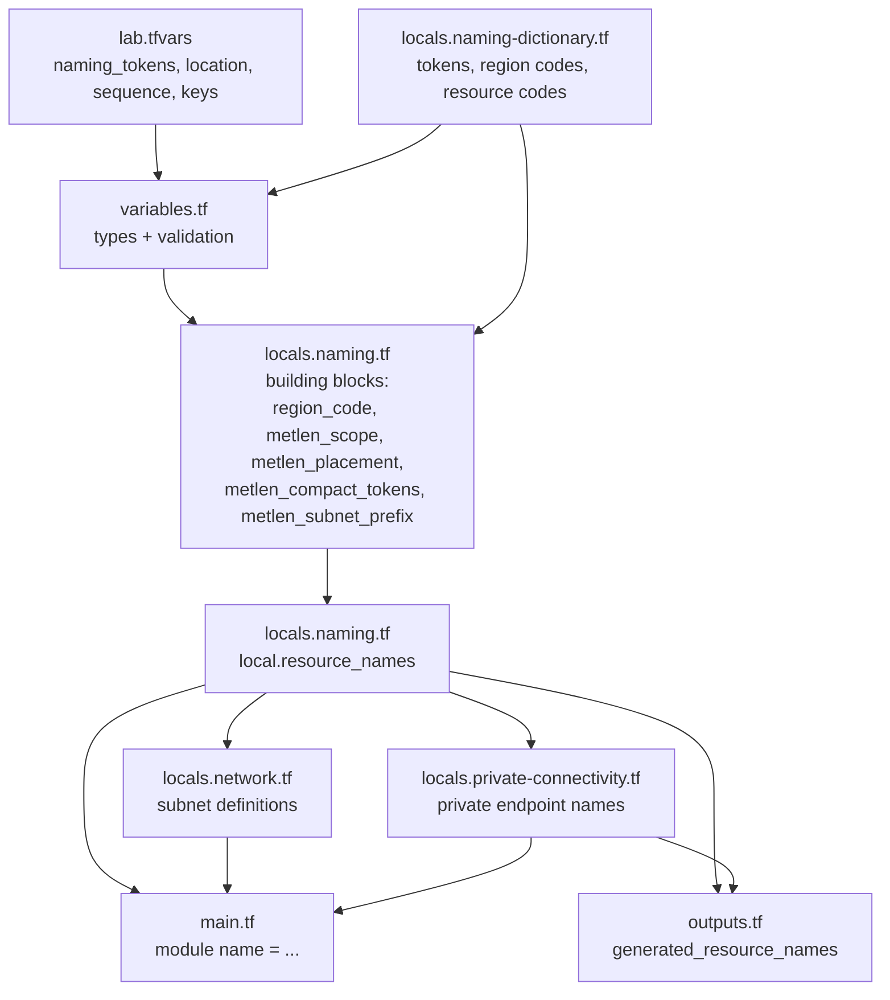
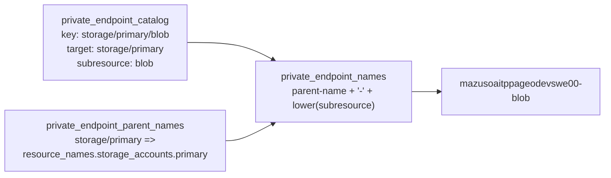

# Naming walkthroughs: from the tfvars values to the Azure names

This document follows real inputs through the Terraform files of
[environments/metlenwithnaming](../environments/metlenwithnaming), one resource
family at a time. Each walkthrough shows the same path:

```text
tfvars value  ->  variables.tf check  ->  dictionary look-up  ->  building-block locals  ->  resource_names  ->  consumer
```

It complements two reference documents:

- [metlen-naming-locals.md](metlen-naming-locals.md): what each local is and which family each resource uses.
- [naming-standard-v0.2-implementation.md](naming-standard-v0.2-implementation.md): requested versus implemented names.

Every value below was evaluated with `terraform console` against
[lab.tfvars](../environments/metlenwithnaming/lab.tfvars) and the current
locals, not typed by hand.

## 0. The map

### 0.1 Files and what they do

| File | Role in naming |
|---|---|
| [lab.tfvars](../environments/metlenwithnaming/lab.tfvars) | **Input.** Tokens, region, sequences, keys. |
| [variables.tf](../environments/metlenwithnaming/variables.tf) | **Gate.** Types and `validation` blocks. Reads the dictionary; rejects anything not approved or not unique. |
| [locals.naming-dictionary.tf](../environments/metlenwithnaming/locals.naming-dictionary.tf) | **Register.** Approved tokens, region codes, 3-character resource codes. |
| [locals.naming.tf](../environments/metlenwithnaming/locals.naming.tf) | **Factory.** Building-block locals and `local.resource_names`, the map of every name. |
| [locals.network.tf](../environments/metlenwithnaming/locals.network.tf) | **Consumer.** Puts the subnet names into the subnet definitions. |
| [locals.private-connectivity.tf](../environments/metlenwithnaming/locals.private-connectivity.tf) | **Second-level factory.** Private endpoint names built from the finished parent names. |
| [main.tf](../environments/metlenwithnaming/main.tf) | **Consumer.** Hands each name to its module. Modules never build names. |
| [outputs.tf](../environments/metlenwithnaming/outputs.tf) | **Mirror.** `generated_resource_names` publishes everything. |

[locals.tags.tf](../environments/metlenwithnaming/locals.tags.tf) holds the tags, not names.

### 0.2 Data flow



Terraform orders locals by their references, not by file order, so the files
can be read in any order. What matters is who depends on whom, as drawn above.

### 0.3 The inputs used in the walkthroughs

These are the naming-relevant parts of `lab.tfvars` (the application token is
`GEO`, a sandbox test value, instead of the standard's example `ECM`):

```hcl
location = "swedencentral"

naming_tokens = {
  business_unit = "IT"
  department    = "PPA"
  application   = "GEO"
  environment   = "DEV"
}

project_name = "metlen"   # legacy sample naming (walkthrough 8)
environment  = "lab"      # legacy sample naming, NOT the ENV token
```

### 0.4 How to read a name

```text
M-AZU-NSG-IT-PPA-GEO-PUB-DEV-SWE-01
|     |   |  |   |   |   |   |   +-- NN   sequence (optional)
|     |   |  |   |   |   |   +------ REG  region code
|     |   |  |   |   |   +---------- ENV  environment token
|     |   |  |   |   +-------------- PUB/PRV classifier (network family only)
|     |   |  |   +------------------ APP  application token
|     |   |  +---------------------- DPT  department token
|     |   +------------------------- BU   business unit token
|     +----------------------------- TYPE 3-character resource code
+----------------------------------- fixed METLEN Azure prefix

mazusoaitppageodevswe00
mazu + soa + itppageodevswe + 00     compact family: no hyphens, lowercase
```

## 1. Walkthrough: the Resource Group

The simplest case, and the one every other walkthrough builds on.

**Result:** `M-AZU-RGP-IT-PPA-GEO-DEV-SWE`

| # | File | What happens | Value |
|---|---|---|---|
| 1 | `lab.tfvars` | You set the region and the four tokens | `location = "swedencentral"`, `IT` / `PPA` / `GEO` / `DEV` |
| 2 | `variables.tf` | `location` must have a region code. Each token must be in its dictionary list. BU + DPT + APP must be at most 9 characters | All accepted (`IT`+`PPA`+`GEO` = 8) |
| 3 | `locals.naming-dictionary.tf` | `region_codes["swedencentral"]`, `resource_codes.resource_group` | `SWE`, `RGP` |
| 4 | `locals.naming.tf` | `region_code`, `metlen_scope`, `metlen_placement` | `SWE`, `IT-PPA-GEO`, `DEV-SWE` |
| 5 | `locals.naming.tf` | `resource_group` joins the pieces | `M-AZU-RGP-IT-PPA-GEO-DEV-SWE` |
| 6 | `main.tf` | `module "resource_group"` receives it | `name = local.resource_names.resource_group` |

The code behind steps 2 to 5:

```hcl
# variables.tf (step 2)
validation {
  condition     = contains(keys(local.naming_dictionary.region_codes), lower(replace(var.location, " ", "")))
  error_message = "location has no approved METLEN region code. ..."
}

# locals.naming.tf (steps 4 and 5)
region_code      = local.naming_dictionary.region_codes[lower(replace(var.location, " ", ""))]
metlen_scope     = "${var.naming_tokens.business_unit}-${var.naming_tokens.department}-${var.naming_tokens.application}"
metlen_placement = "${var.naming_tokens.environment}-${local.region_code}"

resource_group = "M-AZU-${local.metlen_codes.resource_group}-${local.metlen_scope}-${local.metlen_placement}"
```

Two things to notice:

- **The region is normalised.** `lower(replace(var.location, " ", ""))` makes
  `"Sweden Central"`, `"swedencentral"` and `"SwedenCentral"` the same key. The
  validation and the look-up use the identical expression, so a location that
  passes the check can never fail the look-up.
- **Scope and placement are separate locals** so the PUB/PRV classifier can sit
  between them (walkthrough 2). `subscription_display_name`
  (`M-AZU-SBS-IT-PPA`) is the one name that uses only BU and DPT; it is
  published as an output and never deployed.

## 2. Walkthrough: network names (VNet, NSG, route table)

The network family inserts a PUB/PRV classifier between scope and placement:
`M-AZU-<TYPE>-<BU>-<DPT>-<APP>-<PUB|PRV>-<ENV>-<REG>[-NN]`.

### 2.1 VNets: the classifier is the network intent

```hcl
virtual_network_names = {
  for key, network in var.virtual_networks :
  key => join("-", ["M-AZU", local.metlen_codes.virtual_network, local.metlen_scope, network.classification, local.metlen_placement])
}
```

`VNT` + `IT-PPA-GEO` + `PRV` + `DEV-SWE` gives `M-AZU-VNT-IT-PPA-GEO-PRV-DEV-SWE`;
a VNet with `classification = "PUB"` gives `M-AZU-VNT-IT-PPA-GEO-PUB-DEV-SWE`.
The map key (`main`, `edge`) never appears in the name. The standard defines no
NN for VNets, so the classification is the only part that tells VNets apart:
`variables.tf` allows at most one PRV and one PUB VNet.

Everything attached to a VNet takes its classification: subnets (section 3),
the VNet's NAT Gateway and Public IP (`M-AZU-NGW-IT-PPA-GEO-PRV-DEV-SWE-00`),
and NSGs and route tables that do not set their own. VNet peerings
(`<local VNet name>-to-<remote VNet name>`) and Private DNS zone links (the
VNet name) are derived from the VNet names.

### 2.2 NSGs and route tables: classifier and sequence come from the input

Input:

```hcl
network_security_groups = {
  compute = { sequence = "01" }
  edge    = { classification = "PUB" }
  plain   = {}
}
```

| Step | File | `compute` | `edge` | `plain` |
|---|---|---|---|---|
| 1 | `variables.tf` defaults | classification `"PRV"`, sequence `"01"` | classification `"PUB"`, sequence `null` | `"PRV"`, `null` |
| 2 | `variables.tf` checks | `PRV` is in `network_classifications`; `01` is two digits | same | same |
| 3 | uniqueness check | key `PRV-01` | key `PUB-none` | key `PRV-none` (distinct, passes) |
| 4 | `locals.naming.tf` | `compact([... "PRV", "DEV-SWE", "01"])` | `compact([... "PUB", "DEV-SWE", null])` | `compact([... "PRV", "DEV-SWE", null])` |
| 5 | Name | `M-AZU-NSG-IT-PPA-GEO-PRV-DEV-SWE-01` | `M-AZU-NSG-IT-PPA-GEO-PUB-DEV-SWE` | `M-AZU-NSG-IT-PPA-GEO-PRV-DEV-SWE` |

```hcl
network_security_groups = {
  for key, nsg in var.network_security_groups :
  key => join("-", compact(["M-AZU", local.metlen_codes.network_security_group, local.metlen_scope, nsg.classification, local.metlen_placement, nsg.sequence]))
}
```

- **`compact()` is what makes NN optional.** A `null` sequence is dropped, so the
  name has no trailing hyphen.
- **The map key (`compute`, `edge`) never appears in the name.** It only ties
  the name to the `subnets` and `security_rules` of the same entry.
- **Route tables work the same way** with code `UDR`: `M-AZU-UDR-IT-PPA-GEO-PRV-DEV-SWE`.
- **Uniqueness is checked on inputs, not names.** `variables.tf` compares
  `"<classification>-<sequence or none>"` across all groups. When a
  `sql_managed_instances` entry exists, its own NSG
  (`sql_managed_instances[<key>].network_security_group_name`) takes
  `PRV-<network_sequence>` too, so `compute = {}` plus SQL MI fails the plan
  until one of them gets a sequence.

## 3. Walkthrough: subnet names

Subnets use a compact pattern, `<DPT><APP><ENV><PUB|PRV><NN>`, for example
`PPAGEODEVPRV01`; PUB/PRV is the classification of the subnet's VNet. Subnet
names are scoped to their VNet, so every VNet reuses the same numbers. There
are two paths to a subnet name.

### 3.1 Fixed roles

```hcl
# locals.naming.tf (condensed)
metlen_subnet_prefix = "${var.naming_tokens.department}${var.naming_tokens.application}${var.naming_tokens.environment}"   # PPAGEODEV
subnet_numbers = {
  private_endpoints = 1, virtual_machines = 2, web_app_integration = 3, function_integration = 4,
  postgresql = 5, mysql = 6, sql_managed_instance = 7, load_balancers = 8
}
# resource_names.virtual_networks[<key>].subnets
subnets = {
  for subnet_key, number in local.subnet_numbers :
  subnet_key => format("%s%s%02d", local.metlen_subnet_prefix, network.classification, number)
}
```

`format("%02d", 1)` pads to `01`. The number belongs to the **role**, so
names never shift when another subnet is switched on or off.

### 3.2 Container Apps environments: the number comes from the input

```hcl
container_apps_environments = { primary = { ... } }   # subnet_number defaults to 9
```

`subnet_name = format("%s%s%02d", local.metlen_subnet_prefix, <classification of the environment's VNet>, environment.subnet_number)`
gives `PPAGEODEVPRV09`. The environment lives in the VNet whose
`subnet_cidrs.container_apps` lists its key. The validation in `variables.tf`
rejects a `subnet_number` that is outside 1 to 99 or that equals the number of
another subnet deployed in the same VNet; setting it to `2` while that VNet
holds the VM subnet fails the plan, but `2` is fine in a VNet without one.
Databricks workspaces work the same way with `host_subnet_number` and
`container_subnet_number` (defaults 10 and 11).

### 3.3 From name to subnet (`locals.network.tf`)

[locals.network.tf](../environments/metlenwithnaming/locals.network.tf) only
consumes the names:

```hcl
subnet_definitions = {
  for network_key, network in var.virtual_networks : network_key => {
    virtual_machines = { name = local.resource_names.virtual_networks[network_key].subnets.virtual_machines, address_prefixes = [network.subnet_cidrs.virtual_machines] }
    ...
  }
}
subnets = {
  for network_key in keys(var.virtual_networks) : network_key => merge(
    { for subnet_key, subnet in local.subnet_definitions[network_key] : subnet_key => subnet if local.subnet_enabled[network_key][subnet_key] },
    <the Container Apps and Databricks subnets placed in this VNet>
  )
}
```

`main.tf` passes `local.subnets[<key>]` to the `module "network"` instance of
each VNet. A name is **always computed**, but a subnet is **created only if a
resource placed in that VNet needs it**:

| Role | NN | Name | Created with `lab.tfvars`? | Why |
|---|---|---|---|---|
| `private_endpoints` | 1 | `PPAGEODEVPRV01` | Yes | Private endpoints are enabled |
| `virtual_machines` | 2 | `PPAGEODEVPRV02` | Yes | VMs and scale sets are defined |
| `web_app_integration` | 3 | `PPAGEODEVPRV03` | Yes | `web_apps` is not empty |
| `function_integration` | 4 | `PPAGEODEVPRV04` | Yes | `function_apps` is not empty |
| `postgresql` | 5 | `PPAGEODEVPRV05` | Yes | `postgresql_servers` is not empty |
| `mysql` | 6 | `PPAGEODEVPRV06` | Yes | `mysql_servers` is not empty |
| `sql_managed_instance` | 7 | `PPAGEODEVPRV07` | No | `sql_managed_instances` is empty |
| `load_balancers` | 8 | `PPAGEODEVPRV08` | No | `load_balancers` is empty |
| `container_apps/primary` | 9 | `PPAGEODEVPRV09` | Yes | Environment `primary` exists |

## 4. Walkthrough: a Storage Account and its private endpoints

This one crosses three files: the compact family, then a name derived from it.

**Result:** `mazusoaitppageodevswe00` and `mazusoaitppageodevswe00-blob`

### 4.1 The Storage Account name

Input: `storage_accounts = { primary = { ... } }`, sequence not set, so it defaults to `"00"`.

| # | File | What happens | Value |
|---|---|---|---|
| 1 | `variables.tf` | Key matches `^[a-z][a-z0-9-]{0,11}$`; sequence is two digits; sequence is unique across `storage_accounts`, `premium_file_accounts` and every `function_apps` `storage_sequence` | Accepted |
| 2 | `locals.naming-dictionary.tf` | `resource_codes.storage_account` | `SOA` |
| 3 | `locals.naming.tf` | `metlen_compact_tokens = lower(BU+DPT+APP+ENV+REG)` | `itppageodevswe` |
| 4 | `locals.naming.tf` | `"mazu" + lower(code) + compact_tokens + sequence` | `mazusoaitppageodevswe00` |
| 5 | `main.tf` | `module "storage"`, `name = local.resource_names.storage_accounts[each.key]` | the name above |

```hcl
storage_accounts = {
  for key, account in var.storage_accounts :
  key => "mazu${lower(local.metlen_codes.storage_account)}${local.metlen_compact_tokens}${account.sequence}"
}
```

**Why BU + DPT + APP is limited to 9 characters** (a rule in `variables.tf`):

```text
mazu (4) + code (3) + BU/DPT/APP (up to 9) + ENV (3) + REG (3) + NN (2) = 24
```

24 is the Storage Account and Key Vault limit. With `IT`/`PPA`/`GEO` (8
characters) the name is 23. The same budget keeps Container App and Function
App names within 32 characters.

The same pattern gives Key Vaults (`mazukvaitppageodevswe00`), Container
Registries (`mazuacritppageodevswe00`), and, with `function_apps.primary.storage_sequence = "01"`,
the Function App host storage (`mazusoaitppageodevswe01`).

### 4.2 The private endpoint name (`locals.private-connectivity.tf`)

A private endpoint name is not built from tokens. It is the **finished name of
its parent plus the service**, so it can never drift from the parent.



```hcl
# 1. The catalog lists every endpoint the lab can create, from variables only
for pair in setproduct(keys(var.storage_accounts), ["blob", "file"]) :
"storage/${pair[0]}/${pair[1]}" => { target = "storage/${pair[0]}", subresource = pair[1], ... }

# 2. Parent names come from resource_names
{ for key, name in local.resource_names.storage_accounts : "storage/${key}" => name }

# 3. The endpoint name
name = "${local.private_endpoint_parent_names[endpoint.target]}-${lower(endpoint.subresource)}"
```

The catalog deliberately holds only plan-time values (no module or name
references) so `for_each` keys are always known and no dependency cycle forms
with the naming locals.

`main.tf` uses `local.private_endpoint_names[key]` in four module calls; the
catalog's `deployed_by` field says which one creates each endpoint:

| Module call | Endpoints | Why it is separate |
|---|---|---|
| `private_endpoints` | One endpoint per parent: Key Vault, Container Registry, Azure SQL, Cosmos DB, Premium Files, Web App | — |
| `storage_private_endpoints` | `blob` and `file` of each Storage Account | A storage account rejects concurrent Private Endpoint connections (`StorageAccountOperationInProgress`), so the `storage-account-private-endpoints` module creates them one at a time |
| `function_storage_private_endpoints` | `blob`, `file`, `queue`, `table` of each Function App's host storage, one call instance per app | Same ordering, and the Function Apps must wait for them |
| `function_app_private_endpoint` | `sites` of each Function App | Other endpoints never wait for the Function Apps |

All private endpoint names with `lab.tfvars`:

| Parent | Subresource | Endpoint name |
|---|---|---|
| Storage Account `primary` | `blob`, `file` | `mazusoaitppageodevswe00-blob`, `-file` |
| Key Vault `primary` | `vault` | `mazukvaitppageodevswe00-vault` |
| Container Registry `primary` | `registry` | `mazuacritppageodevswe00-registry` |
| Azure SQL server `primary` | `sqlServer` | `m-azu-sql-it-ppa-geo-dev-swe-00-sqlserver` |
| Web App | `sites` | `M-AZU-APP-IT-PPA-GEO-DEV-SWE-00-sites` |
| Function App | `sites` | `M-AZU-FUN-IT-PPA-GEO-DEV-SWE-sites` |
| Function host storage | `blob`, `file`, `queue`, `table` | `mazusoaitppageodevswe01-blob`, `-file`, `-queue`, `-table` |

`lower()` is why `sqlServer` becomes `sqlserver`. The private service
connection reuses the endpoint name, and the DNS zone group is always `default`.
PostgreSQL and MySQL flexible servers have no private endpoint: they use their
delegated subnets and private DNS zones.

## 5. Walkthrough: Azure SQL, the lowercase variant

**Result:** server `m-azu-sql-it-ppa-geo-dev-swe-00`, elastic pool `M-AZU-SEL-IT-PPA-GEO-DEV-SWE-00`; the database is named by the application

```hcl
azure_sql_servers = {
  for key, server in var.azure_sql_servers : key => {
    server_name       = lower(join("-", ["M-AZU", local.metlen_codes.azure_sql_server,       local.metlen_scope, local.metlen_placement, server.sequence]))
    database_name     = coalesce(server.database_name, key)
    elastic_pool_name =       join("-", ["M-AZU", local.metlen_codes.azure_sql_elastic_pool, local.metlen_scope, local.metlen_placement, server.sequence])
  }
}
```

| # | Step | Server | Elastic pool |
|---|---|---|---|
| 1 | Input | `azure_sql_servers.primary`, `sequence` defaults to `"00"` | same entry |
| 2 | Code from the dictionary | `azure_sql_server = "SQL"` | `azure_sql_elastic_pool = "SEL"` |
| 3 | Parts | `["M-AZU","SQL","IT-PPA-GEO","DEV-SWE","00"]` | `["M-AZU","SEL","IT-PPA-GEO","DEV-SWE","00"]` |
| 4 | `join("-", ...)` | `M-AZU-SQL-IT-PPA-GEO-DEV-SWE-00` | `M-AZU-SEL-IT-PPA-GEO-DEV-SWE-00` |
| 5 | `lower()` | `m-azu-sql-it-ppa-geo-dev-swe-00` | not applied |

Why the difference: the server name becomes DNS (`<name>.database.windows.net`)
and must be lowercase. The elastic pool (`SEL`) is scoped to its server: it
uses the full family with the server's NN, because each server has at most one
pool. The database follows no convention: it is called whatever
`database_name` says (for example `appdb`), or the entry key (`primary`) when
`database_name` is not set.

The other database services work the same way:

| Service | Server / account | Database (and container) | Code |
|---|---|---|---|
| PostgreSQL | lowercase `m-azu-pgs-it-ppa-geo-dev-swe-00` | `database_name`, default the key | `PGS` |
| MySQL | lowercase `m-azu-mys-it-ppa-geo-dev-swe-00` | `database_name`, default the key; must be lowercase because MySQL stores database names in lowercase | `MYS` |
| Cosmos DB | lowercase `m-azu-cdb-...-00` | `database_name` and `container_name`, default the key; checked against the rules of the account's API | `CDB` |

Blob containers and file shares are the same: the names in `containers` and
the `file_shares` keys are used exactly as written.

## 6. Walkthrough: App Service family and optional NN

```hcl
app_service_plans = {
  for key, plan in var.app_service_plans :
  key => join("-", ["M-AZU", local.metlen_codes.app_service_plan, local.metlen_scope, local.metlen_placement, plan.sequence])
}
web_apps = {
  for key, app in var.web_apps : key => {
    name = join("-", ["M-AZU", local.metlen_codes.app_service, local.metlen_scope, local.metlen_placement, app.sequence])
  }
}
function_apps = {
  for key, app in var.function_apps : key => {
    name                 = join("-", compact(["M-AZU", local.metlen_codes.function_app, local.metlen_scope, local.metlen_placement, app.sequence]))
    storage_account_name = "mazu${lower(local.metlen_codes.storage_account)}${local.metlen_compact_tokens}${app.storage_sequence}"
    content_share_name   = "function-content"
  }
}
```

With `lab.tfvars` (`app_service_plans = { web = { sequence = "00" }, functions = { sequence = "01", sku_name = "EP1" } }`, `web_apps = { primary = { service_plan = "web" } }`, `function_apps = { primary = { service_plan = "functions", storage_sequence = "01" } }`):

| Name | Inputs | Result |
|---|---|---|
| Web App plan `web` | `app_service_plans.web.sequence = "00"` | `M-AZU-ASP-IT-PPA-GEO-DEV-SWE-00` |
| Function App plan `functions` | `app_service_plans.functions.sequence = "01"` | `M-AZU-ASP-IT-PPA-GEO-DEV-SWE-01` |
| Web App | `web_apps.primary.sequence` default `"00"`, runs on `web` | `M-AZU-APP-IT-PPA-GEO-DEV-SWE-00` |
| Function App | `function_apps.primary.sequence` is `null`, runs on `functions` | `M-AZU-FUN-IT-PPA-GEO-DEV-SWE` |
| Function host storage | `function_apps.primary.storage_sequence = "01"` | `mazusoaitppageodevswe01` |

Points worth following through the files:

- **Plans are declared once.** Every plan is `ASP`, so their NN must differ.
  Plan numbers exist only in `app_service_plans`; apps hold just a plan key
  (`service_plan = "web"`), so a Web App plan and a Function App plan cannot
  end up with the same name, and `variables.tf` needs to check uniqueness in
  one map only.
- **Apps can share a plan.** Two Web Apps with `service_plan = "web"` both run
  on `M-AZU-ASP-IT-PPA-GEO-DEV-SWE-00` and share its compute. Give an app its
  own plan entry when it needs isolation.
- **Plans match their apps.** Web Apps need a Basic, Standard or Premium plan;
  Function Apps need an Elastic Premium plan (EP1-EP3); every app's OS must
  match its plan's `os_type` (the Function App takes its OS from its plan). A
  plan that no app uses is reported as a warning, because it is still billed.
- **A second Web App needs its own `sequence`**, because Web App names are
  global.
- **Apps share their integration subnet.** Every `web_apps` entry joins
  `web_app_integration` and every `function_apps` entry joins
  `function_integration`; when apps on more than one plan share a subnet it
  must be `/26` or larger (multi-plan subnet join).
- **The Function App name has no NN in the standard.** `compact()` drops the
  `null`, so at most one `function_apps` entry may leave `sequence` unset; set
  it (for example `"01"`) for every further app or as a fallback when the
  global name is taken (`M-AZU-FUN-IT-PPA-GEO-DEV-SWE-01`, 31 characters). It
  stays within 32 because Azure derives the Functions host ID from the first 32
  characters of the name.
- **Storage NN is shared.** Each Function App has its own host storage, and
  every `function_apps` `storage_sequence` must differ from each other and from
  every `storage_accounts` and `premium_file_accounts` sequence.
- **The content share** is the internal Azure Files share where the Functions
  host keeps the app's code. It is always called `function-content`; each
  Function App has its own host storage account, so the fixed name never
  clashes.

## 7. Walkthrough: one Container Apps environment fans out into many names

One entry in `container_apps_environments` produces names from three
different mechanisms in a single `resource_names` object:

```hcl
container_apps_environments = {
  primary = {
    dedicated_workload_profiles = { general = {...}, memory = {...} }
    apps = { hello = {...} }
  }
}
```

| Name | Mechanism | Built from | Result |
|---|---|---|---|
| Environment | Full family | `CEV`, scope, placement, `environment.sequence` (`"00"`) | `M-AZU-CEV-IT-PPA-GEO-DEV-SWE-00` |
| Subnet | Subnet family | prefix + `subnet_number` (`9`) | `PPAGEODEVPRV09` |
| App `hello` | Lowercase variant | `CAP`, scope, placement, `app.sequence` (`"00"`), then `lower()` | `m-azu-cap-it-ppa-geo-dev-swe-00` |
| Subnet delegation | Legacy stem | `dlg-container-apps-<key>-<stem>` | `dlg-container-apps-primary-metlen-lab-<suffix>` |
| Private DNS links | Derived | name of each linked VNet (the environment's zone is linked to every VNet) | `M-AZU-VNT-IT-PPA-GEO-PRV-DEV-SWE` |
| Workload profile `general` | Own rule | see below | `wp-general01` |
| Workload profile `memory` | Own rule | see below | `wp-memory01` |
| App container | Legacy stem | `ctr-<stem>` | `ctr-metlen-lab-<suffix>` |

**The workload profile rule.** Azure limits profile names to 15 characters:

```hcl
length("${prefix}-${profile_key}01") <= 15
  ? "${prefix}-${profile_key}01"
  : format("%s-%s01", substr(prefix, 0, 3), substr(sha1(profile_key), 0, 8))
```

`wp-general01` (12) and `wp-memory01` (11) fit. A longer key such as
`memoryheavy` would give `wp-memoryheavy01` (16), so the fallback uses a hash
of the key and the name becomes `wp-ec8d642301`. The hash is deterministic, so
the name is stable across runs.

**Subnet and apps follow separate paths to the consumers.** The subnet name
goes to `locals.network.tf` (`container_apps_subnets`); the environment, app,
profile and link names go to `module "container_apps"` in `main.tf`. Apps use
the lowercase variant because Container App names are 2 to 32 lowercase
characters (the 31-character result fits), and their NN must be unique across
all environments.

## 8. Walkthrough: names that still use the legacy stem

Resources without a METLEN convention yet are named
`<prefix>-<key>-<project>-<environment>-<suffix>`. These are VMs, scale sets,
NICs, disks and subnet delegations. VMs and scale sets wait for the METLEN
server naming process (the register marks Virtual Machine as EXCEPTION).

```hcl
naming_suffix   = coalesce(var.naming.unique_suffix, random_string.suffix.result)
name_stem       = "${var.project_name}-${var.environment}-${local.naming_suffix}"
naming_prefixes = var.naming.prefixes
```

Trace for the VM entry `virtual_machines = { primary = { data_disks = { data = {...} } } }`
with `naming.unique_suffix = "k7x2q"`:

| # | Local | Expression | Value |
|---|---|---|---|
| 1 | `naming_suffix` | `coalesce("k7x2q", random_string...)` | `k7x2q` |
| 2 | `name_stem` | `project_name`-`environment`-suffix | `metlen-lab-k7x2q` |
| 3 | VM `name` | `vm` + `-primary-` + stem | `vm-primary-metlen-lab-k7x2q` |
| 4 | NIC | `nic-primary-` + stem | `nic-primary-metlen-lab-k7x2q` |
| 5 | OS disk | `osdisk-primary-` + stem | `osdisk-primary-metlen-lab-k7x2q` |
| 6 | Data disk `data` | `disk-data-primary-` + stem | `disk-data-primary-metlen-lab-k7x2q` |
| 7 | `computer_name` | `"vm-" + first 6 of sha1("primary") + "-" + suffix` | `vm-e3b7c9-k7x2q` |

The `computer_name` is separate from the Azure resource name and is 15
characters with a five-character suffix, the Windows hostname limit.

Three things to know about the legacy names:

1. **Two different "environment" values exist.** `var.environment = "lab"` is
   the legacy label and feeds the stem and the tags. `naming_tokens.environment
   = "DEV"` is the METLEN ENV token. Changing one does not change the other.
2. **With `unique_suffix = null` the stem is unknown until apply.** The suffix
   then comes from `random_string.suffix`, so `terraform console` and
   `terraform plan` show `(known after apply)` for every legacy name (and for
   `subnet_delegation_name`).
   METLEN-family names are always known at plan time. The test suite pins
   `unique_suffix` for this reason.
3. **These locals will go away** as each resource type receives a METLEN code.

## 9. Walkthrough: what happens when an input is wrong

Validation runs before any name is built, and every message comes from
`variables.tf`.

| You set | File that stops it | Message |
|---|---|---|
| `location = "eastus"` | `variables.tf` (`location`) | `location has no approved METLEN region code. Add it to region_codes in locals.naming-dictionary.tf first.` |
| `department = "XYZ"` | `variables.tf` (`naming_tokens`) | `naming_tokens.department is not an approved METLEN department code.` |
| `environment = "TST"` or `"dev"` | `variables.tf` (`naming_tokens`) | `naming_tokens.environment must be DEV, UAT or PRD.` (lowercase fails too, the match is exact) |
| `key_vaults = { primary = {}, secrets = {} }` | `variables.tf` (`key_vaults`) | `Every key_vaults entry needs a unique sequence because Key Vault names must be unique. Current sequences: primary=00, secrets=00.` |
| A new token that makes BU+DPT+APP longer than 9 characters | `variables.tf` (`naming_tokens`) | `naming_tokens business_unit, department and application together must be at most 9 characters so Storage Account and Key Vault names fit 24 characters and Container App and Function App names fit 32.` |

The fix for the duplicate Key Vault is to give each entry its own NN:

```hcl
key_vaults = {
  primary = {}                      # mazukvaitppageodevswe00
  secrets = { sequence = "01" }     # mazukvaitppageodevswe01
}
```

Why the uniqueness checks compare **inputs** and not names: the names depend on
the same variables, so a validation that read `local.resource_names` would form
a dependency cycle. Validations may read `local.naming_dictionary` directly
(Terraform 1.9+) because the dictionary depends on nothing.

## 10. Walkthrough: what changes when I change an input

Starting point: `IT`/`PPA`/`GEO`/`DEV`, `swedencentral`.

| Change | Names that change | Names that do not |
|---|---|---|
| `naming_tokens.environment` `DEV` to `PRD` | Everything built from `metlen_placement`, `metlen_compact_tokens` or `metlen_subnet_prefix`: `M-AZU-RGP-IT-PPA-GEO-PRD-SWE`, `mazusoaitppageoprdswe00`, `PPAGEOPRDPRV02`, and every private endpoint (they follow their parent) | Legacy-stem names (`vm-primary-metlen-lab-<suffix>`): they use `var.environment` |
| `location` to `West Europe` | The REG segment: `M-AZU-RGP-IT-PPA-GEO-DEV-WEU`, `mazusoaitppageodevweu00` (the normalisation makes `West Europe` equal `westeurope`) | Legacy-stem names |
| `storage_accounts.primary.sequence` to `"02"` | That account and its endpoints: `mazusoaitppageodevswe02`, `...02-blob`, `...02-file` | Other storage accounts |
| `resource_codes.key_vault` `KVA` to `KV` in the dictionary | Every Key Vault and its endpoint (`mazukvitppageodevswe00-vault`) | Everything else |
| Rename the map key `primary` to `main` | Legacy-stem names that contain the key (`vm-primary-...` becomes `vm-main-...`), and databases or Cosmos DB containers that take their default name from the key | METLEN-family names: the key is not part of them. Terraform still sees a new `for_each` address and plans to destroy and re-create the resource, unless you add a `moved` block |
| `project_name` or `unique_suffix` | Legacy-stem names only | All METLEN-family names |

Renaming a resource in Azure means **replacement**: Terraform deletes the old
resource and creates the new one. Before applying any naming change to a
resource that holds data, run `terraform plan` and look for `must be replaced`.

## 11. Cheat sheet

### Where do I change it?

| I want to | Edit |
|---|---|
| Use another BU, DPT, APP or ENV value | Add it to the lists in `locals.naming-dictionary.tf`, then set it in `naming_tokens` |
| Support another Azure region | Add `region_codes` entry, for example `northeurope = "NEU"` |
| Change a 3-character resource code | `resource_codes` in `locals.naming-dictionary.tf` |
| Change the pattern of one resource | Its entry in `local.resource_names` in `locals.naming.tf` |
| Give a resource a different NN | Its `sequence` in the tfvars (unique per resource type) |
| Name a second NSG or route table | Give each a different `sequence` or `classification` |
| Add a new resource type | Code in the dictionary, `sequence` input with validations in `variables.tf`, entry in `resource_names`, module call in `main.tf`, test in `tests/` |

### How do I see the names?

```powershell
# Quote the -var-file argument in PowerShell
'local.resource_names.storage_accounts' | terraform console "-var-file=lab.tfvars"
'local.private_endpoint_names["storage/primary/blob"]' | terraform console "-var-file=lab.tfvars"

terraform plan "-var-file=lab.tfvars"      # names appear in the plan
terraform output generated_resource_names  # after apply
terraform test                             # tests/naming.tftest.hcl pins the expected names
```

## Appendix: every name `lab.tfvars` generates

Names marked *suffix* depend on `naming.unique_suffix`; with `null` they are
known only after apply.

| Resource | Name |
|---|---|
| Subscription display name (reference only) | `M-AZU-SBS-IT-PPA` |
| Resource Group | `M-AZU-RGP-IT-PPA-GEO-DEV-SWE` |
| Virtual Network (`main`) | `M-AZU-VNT-IT-PPA-GEO-PRV-DEV-SWE` |
| Subnets | `PPAGEODEVPRV01` to `PPAGEODEVPRV09` (see walkthrough 3) |
| Storage Account `primary` | `mazusoaitppageodevswe00` |
| Blob containers in `primary` | `appdata`, `archive` (as configured) |
| Function host storage | `mazusoaitppageodevswe01` |
| Function App content share | `function-content` |
| Key Vault `primary` | `mazukvaitppageodevswe00` |
| Container Registry `primary` | `mazuacritppageodevswe00` |
| Azure SQL server / database | `m-azu-sql-it-ppa-geo-dev-swe-00` / `database_name` (default `primary`) |
| Azure SQL elastic pool | `M-AZU-SEL-IT-PPA-GEO-DEV-SWE-00` (name only: `elastic_pool.enabled = false`) |
| NAT Gateway / its Public IP | `M-AZU-NGW-IT-PPA-GEO-PRV-DEV-SWE-00` / `M-AZU-PIP-IT-PPA-GEO-PRV-DEV-SWE-00` |
| Private DNS zone links | `M-AZU-VNT-IT-PPA-GEO-PRV-DEV-SWE` (the linked VNet) |
| Log Analytics workspace | `M-AZU-LAW-IT-PPA-GEO-DEV-SWE-00` |
| PostgreSQL server / database | `m-azu-pgs-it-ppa-geo-dev-swe-00` / `database_name` (default `primary`) |
| MySQL server / database | `m-azu-mys-it-ppa-geo-dev-swe-00` / `database_name` (default `primary`) |
| App Service Plans `web` / `functions` | `M-AZU-ASP-IT-PPA-GEO-DEV-SWE-00` / `M-AZU-ASP-IT-PPA-GEO-DEV-SWE-01` |
| Web App (on `web`) | `M-AZU-APP-IT-PPA-GEO-DEV-SWE-00` |
| Function App (on `functions`) | `M-AZU-FUN-IT-PPA-GEO-DEV-SWE` |
| Container Apps environment | `M-AZU-CEV-IT-PPA-GEO-DEV-SWE-00` |
| Container App `hello` | `m-azu-cap-it-ppa-geo-dev-swe-00` |
| Workload profiles | `wp-general01`, `wp-memory01` |
| VM, scale set, NICs, disks, autoscale setting, delegations | Legacy stem, *suffix* |
